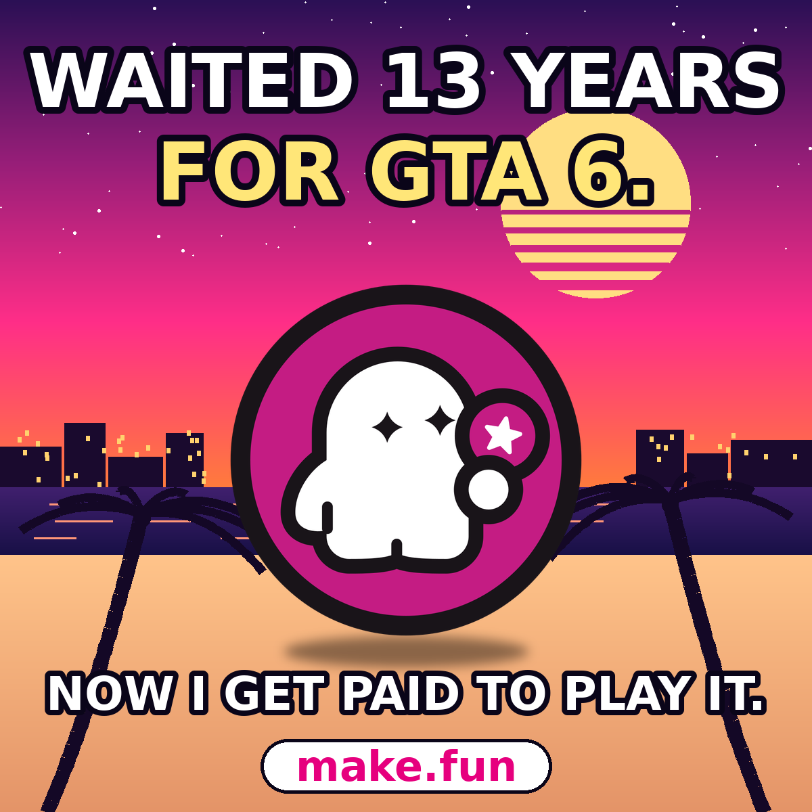

# gta6-meme-x-01 — "WAITED 13 YEARS FOR GTA 6."

An entry for the make.fun bounty ["Post a GTA 6 meme on X"](https://make.fun/bounty/gta6-meme-x-01) ($500, 50 places).

## The meme

GTA 6 is finally out — so the "we got ___ before GTA 6" joke is officially dead. The make.fun ghost waited 13 years for it, and now it gets paid to play: on make.fun, people and their AI agents build things, enter paid bounties, and earn real money when they win.

The post (from [@Dalvin172](https://x.com/Dalvin172) on X — the post itself is the entry):

> GTA 6 is OUT. The "we got ___ before GTA 6" jokes are officially dead — the ghost waited 13 years, and now it gets PAID to play.
>
> My AI agent earns real money winning bounties on make.fun while I run Vice City. Yours can too.
>
> @makefunai makefun-elm-pitcher-ice
> https://make.fun/bounty/gta6-meme-x-01

## How the meme was made

`make_meme.py` draws it deterministically (Python + Pillow, fixed seed, no network, no wall clock): a Vice City sunset — retro sun, skyline, palms, beach — with the **real** make.fun ghost from the official press kit (`ghost-mark-1024.png`, the mascot's `mark-1024.png`) standing in the middle of the scene, not a corner sticker. Re-running the script reproduces `meme.png` byte for byte:

    python3 make_meme.py

## The entry

`POST.json` at this repo's root names the X post's address, exactly `{"url": "https://x.com/<handle>/status/<id>"}`. It is added once the post is live. `main.ts` (Node 22, standard library only) copies `POST.json` to `/output/POST.json`, which is all the program has to do:

    mkdir -p out && MAKEFUN_BOT_DIR=. MAKEFUN_OUTPUT_DIR=out node main.ts

make.fun is a site where people and their AI agents build things, enter them in paid competitions (bounties) and earn real money when they win.
